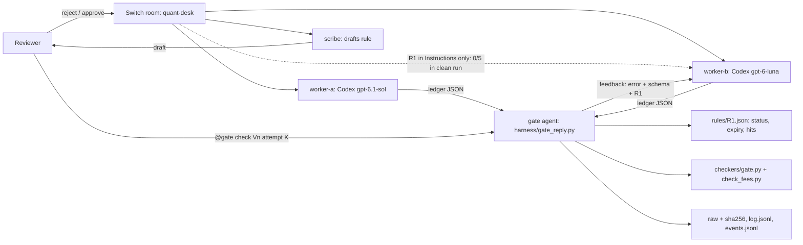

# Second Strike

[](https://github.com/sohamsssssssssssssssss/second-strike/actions/workflows/tests.yml) [](https://github.com/sohamsssssssssssssssss/second-strike/actions/workflows/evidence.yml)

**Second Strike: a Switch room where a human approves a rule once and a gate agent enforces it on every agent's work. Worker first try 0/5 → 5/5 after one gate strike.**

## 30-second summary

- **Problem:** a correction given to one agent in chat does not reach the next agent. A rule in the room Instructions did not either (0/5).
- **What a human does:** approves a rule once in chat, and can revoke it in chat (`@gate revoke R1`).
- **What agents do:** the worker submits a ledger and calls `@gate` itself. The gate runs a deterministic checker and posts the exact fix (error, schema, rule text). The worker resubmits.
- **Result** (n=5 per row, Codex gpt-6-luna workers, synthetic ledgers):

| Arm | Worker compliant |
| --- | --- |
| Rule in room Instructions only | 0/5 |
| Generic "fix your mistakes" retry | 0/5 (worker asked which rule; no resubmission) |
| Exact gate feedback | 0/5 first try → 5/5 after one strike |
| Autonomous: worker triggers the gate itself | 4/5 first try → 5/5 |
| Rule and schema written into the prompt, no gate | 5/5 (nothing checks it) |

Observed, not causal. All 27 recorded gate checks are hashed and replay offline (`python3 harness/verify_evidence.py`, run in CI). See [Results](#results) for caveats; first-try rates are not comparable across runs.

## FAQ

**Why not just put the rule in the prompt?** It works (5/5), but it relies on every requester remembering every rule, and nothing checks the output. The gate checks every output and delivers the rule only when it is missed. A generic "fix your mistakes" gave 0/5: the worker asked which rule and declined to guess. Exact gate feedback gave 5/5.

**What is automated, and how is this different from CI?** The gate runs inside the agents' conversation. Workers trigger it themselves (`eval/autorun/`), and its feedback goes straight back to the agent, which resubmits. CI only fails a build.

**Can I add a new rule without changing Python?** Yes. Add `rules/R2.json` naming a checker file; the gate loads it by path (`tests/test_rules_pluggable.py`). See [Rules are pluggable](#rules-are-pluggable).

## How Switch is used

| Switch piece | In Second Strike |
| --- | --- |
| Agents | `worker-b` (Codex gpt-6-luna), `worker-a` (Codex gpt-6.1-sol), `gate` (Codex), `scribe` (Codex). Gate and scribe model IDs are not recorded. |
| Rooms (Mattermost channels) | `quant-desk` (correction, scribe draft, approval), `rescue` (second-strike run), `clean-treat` / `clean-control` (clean matched run), `schema-arm` (comparison arm), `generic-retry` (generic-feedback arm), `auto-run` (autonomous run), `quant-desk-live` (smoke test) |
| Human | Rejects the ledger, approves R1 in chat (message `dx95znbbq7dtixxhouksnsomnh`), sends tasks, revokes with `@gate revoke R1`. In the rescue, schema, and generic runs, the human also triggered `@gate check Vn attempt K` |
| Worker agent | In `auto-run`, after each ledger it posts `@gate run auto check Vn attempt K` itself, and resubmits when the gate mentions it. No human mentions the gate |
| Gate agent | Lives in the room. On a mention it saves the worker's reply verbatim, runs `harness/gate_reply.py` (hash, extract, `checkers/gate.py`), and posts the verdict. On fail or escalate it mentions the worker with the exact error, schema, and R1 text |
| Room Instructions | Carry the approved R1 text |

Setup files: [templates/gate-agent-instructions.md](templates/gate-agent-instructions.md), [templates/worker-instructions.md](templates/worker-instructions.md), [templates/rescue-room.md](templates/rescue-room.md).

Without Switch there is no shared room where the correction, the human approval, and the gate verdicts sit in one thread. There is no gate agent inside the conversation to send the rule back to the worker. And there is no approval trail tying R1 to a human message.

Status: prototype. Synthetic backtest ledgers only. Five live runs of n=5 (clean, rescue, schema, generic, autonomous), one smoke test, one worker model. Earlier history is in [docs/README-history.md](docs/README-history.md).

## Problem

A correction given to one agent in chat does not reach the next agent. A rules file helps one tool. Neither gives the team a shared, approved, checkable record of what was corrected.

## How it works

task → worker ledger → human correction → scribe draft → human approval → R1 record + room Instructions → later worker → gate → feedback → worker resubmits → gate

1. A worker builds a synthetic backtest ledger from a plain task. The seeded flaw: no per-trade fee.
2. The reviewer rejects it: fees are missing.
3. The scribe drafts a rule: fee = 0.0005 × qty × price, tolerance 0.01.
4. The reviewer approves in the room. Only this step activates a rule.
5. The approved text goes into `rules/R1.json` and the room Instructions.
6. A later worker gets a new task and the Instructions. The clean run found this alone did not change fee inclusion (0/5 vs 0/5).
7. The gate (`checkers/gate.py`) checks the ledger deterministically. This is where the approved rule is enforced.
8. On escalate or fail, the gate posts feedback: the exact error, the required per-trade schema or the offending fees, and the R1 text. Nothing else.
9. The worker resubmits and the gate re-checks. That resubmission is the second strike.

## Architecture



In the `rescue` room the gate agent ran `harness/gate_reply.py` when the reviewer mentioned it. In `auto-run`, worker-b mentioned the gate itself.

## What is implemented

| Component | State |
| --- | --- |
| Switch room `quant-desk` with worker-a, worker-b, scribe, gate, reviewer | Deployed from `templates/quant-desk-fallback.template.yaml` (same vendor, different models) |
| Human-approved R1 in room Instructions | Done; approval reference `dx95znbbq7dtixxhouksnsomnh` |
| `checkers/check_fees.py` | Fee check. JSON or CSV. Exit 0 pass, 1 fail, 2 escalate |
| `checkers/check_traded_value.py` | R2 check: `traded_value` equals the sum of qty × price, tolerance 0.01 |
| `checkers/gate.py` | Loads a rule record and the checker file it names (a `.py` inside the repo). Enforces expiry and revoke. Counts hits and last_fired. Appends events to `rules/events.jsonl`. `--revoke BY`. Exit 0 pass, 1 fail, 2 escalate, 3 not enforced |
| `harness/paired_test.py` | Hashes two saved JSON files and reports their verdicts. Runs no agents |
| `harness/gate_reply.py` | Gates one worker reply. Saves the raw message and its sha256 before grading, extracts the JSON ledger, runs the gate, prints the verdict and worker feedback, and appends to `eval/<run>/log.jsonl`. Refuses to overwrite a recorded attempt (exit 4) |
| `harness/rescue_report.py` | Turns a `gate_reply` log into a per-variant table: attempt 1 vs attempt 2, first-try and second-strike totals |
| `harness/verify_evidence.py` | Re-hashes every raw reply in `eval/*/raw/` and replays each logged verdict. Runs in CI (`evidence.yml`) |
| Tests | 20 unittest cases (`tests/`) |
| Fixtures | 10 valid ledgers; variant treatment and control outputs in `eval/ledgers/` |

`checkers/check_lookahead.py`, `harness/eval.py`, and `templates/life-room.template.yaml` are placeholders. They are not implemented.

## Quickstart

Run from the repo root. Expected results are in comments.

```bash
python3 -m unittest discover -s tests -v                     # Ran 20 tests ... OK
python3 harness/verify_evidence.py                           # 27/27 recorded gate checks reproduce across 5 runs
python3 checkers/check_fees.py eval/ledgers/ex_pass_fees.json  # pass, exit 0
python3 checkers/check_fees.py eval/ledgers/ex_fail_fees.json  # fail, exit 1
```

The gate writes to `rules/` (hits, last_fired, `events.jsonl`). Run it on a copy so the recorded rule stays unchanged:

```bash
cp -R . ../second-strike-run && cd ../second-strike-run
python3 checkers/gate.py rules/R1.json eval/ledgers/ex_fail_fees.json   # fail, exit 1, hits +1
python3 checkers/gate.py rules/R1.json eval/ledgers/ex_fail_fees.json --now 2026-12-01T00:00:00+05:30   # not_enforced, expired, exit 3
python3 checkers/gate.py rules/R1.json --revoke Soham                    # status revoked
python3 checkers/gate.py rules/R1.json eval/ledgers/ex_fail_fees.json   # not_enforced, revoked, exit 3
cat rules/events.jsonl
```

Without `--now`, the gate uses the current clock. After 30 Nov 2026 the rule reports `expired`.

## Rules are pluggable

A rule is a JSON record that names its checker file. `gate.py` loads that file by path (`load_checker`), so a new rule needs no gate change. The checker must be a `.py` file inside the repo and expose `check(ledger)`.

Example: `rules/R2.json` names `checkers/check_traded_value.py` (`traded_value` must equal the sum of qty × price, tolerance 0.01). It is motivated by V4 control reporting 906 against trades totalling 905. R2 has status `draft`, so the gate reports `not_enforced` until a human approves it and sets status `active`. `tests/test_rules_pluggable.py` covers R2 pass, fail, and escalate, the draft state, and rejecting checker paths outside the repo.

```bash
python3 checkers/gate.py rules/R2.json eval/ledgers/ex_pass_fees.json   # not_enforced (draft), exit 3
```

## Reproduce live (Switch)

1. Install Switch and sign in to the Codex provider in the Switch Console.
2. Create two agents on This computer: `worker-b` (Codex gpt-6-luna) and `gate` (Codex). Give the gate a working directory `<gate-dir>`, and copy `rules/R1.json` into it.
3. Paste [templates/worker-instructions.md](templates/worker-instructions.md) (base text) into worker-b. Paste [templates/gate-agent-instructions.md](templates/gate-agent-instructions.md) into the gate, with `<repo>` and `<gate-dir>` filled in.
4. Create the room `rescue` as described in [templates/rescue-room.md](templates/rescue-room.md), with R1 in the room Instructions.
5. Send `tasks/seeded/variant-01.txt` to `@worker-b`, verbatim.
6. Post `@gate check V1 attempt 1`. If the verdict is fail or escalate, the gate mentions worker-b with the error, schema, and R1 text.
7. After worker-b resubmits, post `@gate check V1 attempt 2`.
8. `python3 harness/rescue_report.py <gate-dir>/eval/rescue/log.jsonl` prints the per-attempt table.

Agent replies vary. Expect the loop to run, not identical verdicts.

## Results

### What we learned

Rules in room Instructions don’t reach agents. Second Strike enforces approved rules at the gate and feeds the exact rule back when a task misses it, with every output checked.

| Run | Where R1 reached the worker | Fees and schema correct |
| --- | --- | --- |
| Clean matched run (`eval/clean/`) | Room Instructions only | 0/5 (control 0/5) |
| Second-strike run (`eval/rescue/`) | Room Instructions, then gate feedback on failure | 0/5 first try → 5/5 after one strike |
| Comparison arm (`eval/schema/`) | Room Instructions plus rule and schema in the prompt; no gate feedback | 5/5 first try |
| Generic-retry arm (`eval/generic/`) | Room Instructions, then only "fix your mistakes" on failure | 0/5 first try; 0/5 final (no resubmissions) |
| Autonomous run (`eval/autorun/`) | Room Instructions, worker triggers the gate, gate feedback on failure | 4/5 first try → 5/5 after one strike |

Observed, not causal. n=5 per run, one model. Caveats are listed under each run. First-try rates are not comparable across runs: worker-b had seen gate feedback in earlier rooms before the autonomous run.

### Second-strike run, 7 Nov 2026, 18:23–18:46 IST (`eval/rescue/`)

A new room, `rescue`, with worker-b and the gate, and R1 text in the room Instructions. Prompts are `tasks/seeded/variant-0n.txt`, verbatim. The reviewer triggered the gate with "@gate check Vn attempt K". The gate ran `harness/gate_reply.py` and posted its feedback. The only feedback worker-b got was gate output. Maximum 2 attempts.

`python3 harness/rescue_report.py eval/rescue/log.jsonl`:

| Variant | Attempt 1 | Attempt 2 |
| --- | --- | --- |
| V1 | escalate | pass |
| V2 | escalate | pass |
| V3 | escalate | pass |
| V4 | escalate | pass |
| V5 | escalate | pass |

first-try pass 0/5, pass by second strike 5/5

- Attempt-1 replies had no trade IDs, no fees, and used `quantity`. After the gate's feedback (exact schema plus R1 text), every resubmission had IDs, `qty`, and correct fees.
- Verification:
  - All 10 raw replies in `eval/rescue/raw/` were saved and sha256-hashed by `gate_reply.py` before grading (`log.jsonl`).
  - An offline replay matched all 10 hashes, and `check_fees.py` reproduced every verdict.
  - `report.md` is `rescue_report.py` output.
  - Re-checked independently on 7 Nov: hashes match, verdicts replay, and the report regenerates identically.

Caveats (from `eval/rescue/results.md`):
- The gate is triggered by a human mention, not autonomously.
- One shared room: the V2–V5 first tries could see earlier gate feedback in the room history. They still escalated (0/5).
- Raw is the text as the gate agent copied it, not a Mattermost API export.
- Setup: the gate's auto mode was switched on, because approval prompts couldn't be answered in-thread. The gate cannot write to `~/Documents`, so it used its own R1 copy and eval folder in its Switch agent directory, and the results were copied here.
- `R1.after.json` is that copy after the run. It has hits 0, because escalations do not count as fee hits.
- An earlier V1 gate trigger failed (PermissionError on mkdir; nothing saved), and another was stopped at an approval prompt. Neither produced a graded record.
- Same worker, same model, n=5. This shows the loop works, not general reliability.
- The same rule and schema text in the first prompt, with no gate feedback, also gave 5/5 (comparison arm below). So this run does not show the gate loop beats telling the worker up front. What the gate adds is delivery on failure, without relying on each requester to write the rule into the prompt, and a deterministic check of every output. A generic "fix your mistakes" gave 0/5 (generic-retry arm below).

### Comparison arm: rule and schema in the prompt, 7 Nov 2026, 19:57–20:15 IST (`eval/schema/`)

A new room, `schema-arm`, with worker-b only during generation, R1 in the room Instructions, and no gate. Prompt: `tasks/seeded/variant-0n.txt` verbatim plus the gate's failure text: "Each trade needs: id (unique), symbol, side (buy|sell), qty > 0, price > 0, fee. R1: Each synthetic backtest trade must include a fee equal to 0.0005 * qty * price, within an absolute tolerance of 0.01." After all 5 replies, the gate was added and graded each first reply (run `schema`, no feedback to the worker).

`python3 harness/rescue_report.py eval/schema/log.jsonl`:

| Variant | Attempt 1 | Attempt 2 |
| --- | --- | --- |
| V1 | pass | — |
| V2 | pass | — |
| V3 | pass | — |
| V4 | pass | — |
| V5 | pass | — |

first-try pass 5/5, pass by second strike 5/5

- Verification, re-checked independently on 7 Nov: all 5 raw hashes match `log.jsonl`, `check_fees.py` replays every verdict as pass, every trade has `id`, `qty`, and `fee`, and the report regenerates identically.
- Without a gate, nobody checks these outputs; the pass grades here were added after generation.

Caveats (from `eval/schema/results.md`):
- The first gate trigger used the rescue run name and was refused (exit 4, nothing overwritten). That trigger message contained "@worker-b", which pinged worker-b. Any reply it made is not graded.
- The gate's instructions were edited before grading to accept a run name.
- Same caveats as the rescue run: human-triggered gate, raw text as the agent copied it, one worker, one model, n=5.

### Generic-retry arm, 7 Nov 2026, 22:53–23:00 IST (`eval/generic/`)

Question: does the gate's exact feedback matter, or would any "try again" work? Room `generic-retry` (new): control-worker-fresh (Codex gpt-6-luna, same base instructions as worker-b, never shown gate feedback) plus the gate, with R1 in the room Instructions. Same 5 frozen prompts. The gate ran the same check (run `generic`) but posted only: "R1 gate: <verdict> (Vn, attempt K). Your ledger does not meet the team rule. Please fix your mistakes and resubmit the full ledger as JSON in a fenced code block." There was no error, schema, or rule text.

| Variant | Attempt 1 | Worker's response to generic feedback |
| --- | --- | --- |
| V1–V5 | escalate (no IDs, no fees, `quantity`) | Asked the gate which rule or field failed; did not resubmit |

Final compliance 0/5. With exact feedback (rescue run): 0/5 → 5/5.

Caveats (from `eval/generic/results.md`):
- A different worker agent from the rescue run (control-worker-fresh vs worker-b), chosen because worker-b had already seen gate feedback. Same model and base instructions. n=5.
- Gate triggered by a reviewer mention. Raw is the text as the gate agent copied it; hashes in `log.jsonl` were saved before grading.

### Autonomous run, 7 Nov 2026, 22:07–22:14 IST (`eval/autorun/`)

Room `auto-run` (new): worker-b plus the gate, with R1 in the room Instructions. The human (Claude acting as reviewer) only sent the 5 frozen task prompts and never mentioned `@gate`. worker-b's instructions end with the auto-trigger line from `templates/worker-instructions.md`.

`python3 harness/rescue_report.py eval/autorun/log.jsonl`:

| Variant | Attempt 1 | Attempt 2 |
| --- | --- | --- |
| V1 | escalate | pass |
| V2 | pass | — |
| V3 | pass | — |
| V4 | pass | — |
| V5 | pass | — |

first-try pass 4/5, pass by second strike 5/5

- worker-b triggered all 6 gate checks. The V1 resubmission followed the gate's own mention of worker-b: an agent-to-agent loop in the Switch room.

Caveats (from `eval/autorun/results.md`):
- worker-b's first tries mostly include fees here (4/5), unlike the rescue run (0/5). worker-b had since received gate feedback and the schema prompt in other rooms; whether its Codex session carries that over is not known. Do not compare first-try rates across runs.
- The V1 first try had fees but no trade IDs (escalate); one strike fixed it.
- Same worker, same model, n=5. Raw is the text as the gate agent copied it.

### Live room smoke test, 7 Nov 2026, 21:42–21:45 IST (`eval/auto/`)

n=1. A smoke test of the chat-native loop, not an experiment. Room `quant-desk-live`: worker-a, worker-b, gate, and Soham, with R1 in the room Instructions. The worker instructions end with the auto-trigger line from `templates/worker-instructions.md`.

- Soham sent V1 to worker-a. worker-a posted a ledger, then posted "@gate run auto check V1 attempt 1" itself, with no human trigger. Gate verdict: pass. worker-a included fees on its first try; n=1, no claim.
- Soham posted "@gate revoke R1". The gate ran `gate.py --revoke` on its R1 copy and posted `{"rule_id":"R1","status":"revoked","by":"user"}` (`R1.revoked-test.json`, `events.jsonl`).
- The gate's R1 copy was restored to active afterwards, from a backup taken before the revoke, for the demo recording. The repo's `rules/R1.json` was not touched.
- Re-checked in the repo: the raw sha256 matches `log.jsonl`, and `check_fees.py` replays pass. The absolute gate path in `events.jsonl` is replaced with `<gate-dir>`.

### Clean matched run, 7 Nov 2026 (`eval/clean/results.md`)

Prompts are `tasks/seeded/variant-0n.txt`, sent once each, with no retries or hints. Treatment and control use fresh rooms. Both use gpt-6-luna, both have auto mode off, and both use the same sender. The treatment room has R1 in its Instructions. The control room's Instructions are blank. That is the only intended difference.

| Variant | Treatment: fees included | Control: fees included | Trade IDs (both arms) |
| --- | --- | --- | --- |
| V1 | No | No | No |
| V2 | No | No | No |
| V3 | No | No | No |
| V4 | No | No | No |
| V5 | No | No | No |
| **Total** | **0/5** | **0/5** | **0/5** |

- All ten replies use `quantity` instead of `qty` and have no trade IDs. `check_fees.py` would return escalate (exit 2), not a fee-only fail.
- Replies were read from the screen, not captured byte-exact. Raw payloads are in Mattermost channels `clean-treat` and `clean-control`. Export, hash, and grade them before treating these counts as final. `eval/clean/raw/` is empty.
- Setup changes for this run: the control's auto mode was switched on→off, and the treatment's addressing was switched to Anyone. The treatment's revert is not recorded in the results file.

### Preliminary: earlier quant-desk runs

These came from the `quant-desk` room, which contains the correction, scribe draft, and approval in its chat history. They are not matched comparisons. The "thread visible" reading is an observation, not a tested cause.

Preliminary (from `eval/results.md`). Not a matched comparison. No causal claim.

| Variant | Treatment checker | Control checker | Note |
| --- | --- | --- | --- |
| V1 | pass | escalate (missing trade IDs) | Control in a public room; not admissible |
| V2 | not captured | not captured | Incomplete |
| V3 | pass | not graded (pasted reply, not saved) | Preliminary |
| V4 | pass | escalate (missing trade IDs) | Preliminary; configuration and history confounds |
| V5 | pass | escalate (missing trade IDs) | Preliminary; configuration and history confounds |

- Valid fixtures: 10 of 10 pass. 0 false blocks.
- Admitted clean matched pairs: 0.
- Controls escalate because trade IDs are missing. They also omit fees and use `quantity` instead of `qty`. An escalation is not a fee-only failure.

## Limitations

- No causal claim. The clean run is matched by design, but its replies are screen-read and unhashed, so it is not yet an admitted pair set. Earlier quant-desk pairs: 0 admissible. V2 is missing from the earlier runs. V3 control was not saved.
- The clean run tested fresh rooms with Instructions only. It did not test an agent added to an existing room, or the correction thread visible in a fresh room.
- Schema errors escalate rather than fail on fees, and escalations do not increment `hits`. The rescue run left hits at 0 even though the gate stopped 5 of 5 first tries.
- Model routing per request is not traced. Current settings show worker-b and control-worker-fresh both configured as gpt-6-luna. That does not prove historical routing.
- Both workers are Codex on different models. This is same vendor, not cross-vendor.
- R1 validates per-trade fees only. It does not check net return, `traded_value`, provenance, or strategy quality. R2 (`traded_value`) exists as a draft and is not enforced.
- Synthetic data only. No real backtest returns.
- Lifecycle (expiry, revoke) is custom. `gate.py` enforces it; the room Instructions do not. Switch's native command registry has no `revoke`. Chat revoke works only through the gate agent (`@gate revoke R1`), shown once in the smoke test.
- Human approval is a chat message reference. `rules/R1.json` is a custom record, not a native Switch Rule or Decision.
- `hits` counts gate failures only. Overrides are not implemented.
- In the rescue, schema, and generic runs, the gate ran only when a human mentioned it. Worker-triggered gating was run once at n=5 (`eval/autorun/`) and once at n=1 (`eval/auto/`).
- Checkers are loaded and executed from the repo. Anyone who can edit `rules/` and `checkers/` can change what runs.
- Gate and scribe model IDs are not recorded.
- `rules/R1.json` and `events.jsonl` have no signing or auth. Anyone with the repo can edit them.
- Not a general reliability guarantee. Rules do not prevent repeat mistakes.

## Future work

- Lookahead checker (placeholder only).
- Human approval flow for R2 (draft today).
- Life Room skin (template only).
- Native Switch Rules and Decisions (not established).
- Cross-vendor workers (OpenCode and Gemini not verified).
- Activation test on a rule's own examples before it goes live (R6).
- Override and escalation flows.
- Full evaluation runner, and capture of V2 evidence.
- Matched five-pair study.
- Export, hash, and grade the clean-run raw payloads into `eval/clean/raw/`.
- Clean control with the correction thread visible in the fresh room, to test the thread reading directly.
- Autonomous runs with more workers, models, and vendors.
- Mattermost API export of the rescue replies, reconciled with `eval/rescue/raw/`.

## Files

| Path | Purpose |
| --- | --- |
| `checkers/check_fees.py` | Fee rule check |
| `checkers/gate.py` | Rule lifecycle plus fee check; writes hits and events |
| `harness/paired_test.py` | Freezes and compares two saved JSON outputs |
| `rules/R1.json` | Active custom rule record |
| `rules/events.jsonl` | Append-only gate events (created on first gate run) |
| `eval/ledgers/` | Fixtures and saved variant outputs |
| `eval/results.md` | Preliminary P4 results and evidence notes |
| `eval/clean/results.md` | Clean matched run: setup, screen-read replies, result |
| `harness/gate_reply.py`, `harness/rescue_report.py` | Gate one worker reply; summarise a rescue log |
| `eval/rescue/R1.before.json` | Snapshot of `rules/R1.json` (hits 0) taken before the rescue run |
| `eval/rescue/results.md`, `report.md` | Second-strike run: setup, result, verification, caveats; report output |
| `eval/rescue/log.jsonl`, `eval/rescue/raw/` | Per-attempt verdicts and hashes; the 10 raw replies |
| `eval/rescue/R1.after.json` | The gate's R1 copy after the run |
| `eval/schema/` | Comparison arm: results, report, log, and the 5 raw replies |
| `eval/auto/` | Live room smoke test (n=1): worker self-trigger, chat revoke |
| `eval/autorun/` | Autonomous run (n=5): worker-triggered gate |
| `eval/generic/` | Generic-retry arm (n=5) |
| `rules/R2.json`, `checkers/check_traded_value.py` | Draft second rule and its checker |
| `harness/verify_evidence.py`, `.github/workflows/` | Evidence replay and tests in CI |
| `templates/gate-agent-instructions.md`, `templates/worker-instructions.md`, `templates/rescue-room.md` | Switch agent instructions and room setup |
| `eval/frozen_hashes.txt`, `eval/live_hashes.txt` | SHA-256 manifests |
| `templates/` | Switch room templates |
| `docs/` | Product, technical, flow, schema, tracker, and rules docs; `README-history.md` |
| `DEMO.md` | 95-second shot list |
| `tests/` | Unit tests |
