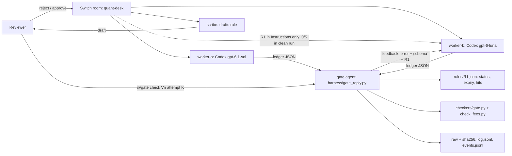

# Second Strike

**Second Strike: a Switch room where a human approves a rule once and a gate agent enforces it on every agent's work. Worker first try 0/5 → 5/5 after one gate strike.**

n=5, one worker, one model, gate triggered by a human mention. See [Results](#results) for caveats and [What we learned](#what-we-learned).

## How Switch is used

| Switch piece | In Second Strike |
| --- | --- |
| Agents | `worker-b` (Codex gpt-6-luna), `worker-a` (Codex gpt-6.1-sol), `gate` (Codex), `scribe` (Codex). Gate and scribe model IDs are not recorded. |
| Rooms (Mattermost channels) | `quant-desk` (correction, scribe draft, approval), `rescue` (second-strike run), `clean-treat` / `clean-control` (clean matched run), `schema-arm` (comparison arm), `quant-desk-live` (smoke test) |
| Human | Rejects the ledger, approves R1 in chat (message `dx95znbbq7dtixxhouksnsomnh`), sends tasks, triggers `@gate check Vn attempt K`, revokes with `@gate revoke R1` |
| Gate agent | Lives in the room. On a mention it saves the worker's reply verbatim, runs `harness/gate_reply.py` (hash, extract, `checkers/gate.py`), and posts the verdict. On fail or escalate it mentions the worker with the exact error, schema, and R1 text |
| Room Instructions | Carry the approved R1 text |

Setup files: [templates/gate-agent-instructions.md](templates/gate-agent-instructions.md), [templates/worker-instructions.md](templates/worker-instructions.md), [templates/rescue-room.md](templates/rescue-room.md).

Without Switch there is no shared room where the correction, the human approval, and the gate verdicts sit in one thread. There is no gate agent inside the conversation to send the rule back to the worker. And there is no approval trail tying R1 to a human message.

Status: prototype. Synthetic backtest ledgers only. The live paired study is incomplete. Earlier history is in [docs/README-history.md](docs/README-history.md).

## Problem

A correction given to one agent in chat does not reach the next agent. A rules file helps one tool. Neither gives the team a shared, approved, checkable record of what was corrected.

## How it works

task → worker ledger → human correction → scribe draft → human approval → R1 record + room Instructions → later worker → gate → feedback → worker resubmits → gate

1. A worker builds a synthetic backtest ledger from a plain task. The seeded flaw: no per-trade fee.
2. The reviewer rejects it: fees are missing.
3. The scribe drafts a rule: fee = 0.0005 × qty × price, tolerance 0.01.
4. The reviewer approves in the room. Only this step activates a rule.
5. The approved text goes into `rules/R1.json` and the room Instructions.
6. A later worker gets a new task and the Instructions. The clean run found this alone did not change fee inclusion (0/5 vs 0/5).
7. The gate (`checkers/gate.py`) checks the ledger deterministically. This is where the approved rule is enforced.
8. On escalate or fail, the gate posts feedback: the exact error, the required per-trade schema or the offending fees, and the R1 text. Nothing else.
9. The worker resubmits and the gate re-checks. That resubmission is the second strike.

## Architecture



In the `rescue` room the gate agent runs `harness/gate_reply.py` when the reviewer mentions it. It is not autonomous.

## What is implemented

| Component | State |
| --- | --- |
| Switch room `quant-desk` with worker-a, worker-b, scribe, gate, reviewer | Deployed from `templates/quant-desk-fallback.template.yaml` (same vendor, different models) |
| Human-approved R1 in room Instructions | Done; approval reference `dx95znbbq7dtixxhouksnsomnh` |
| `checkers/check_fees.py` | Fee check. JSON or CSV. Exit 0 pass, 1 fail, 2 escalate |
| `checkers/gate.py` | Loads `rules/R1.json`. Enforces expiry and revoke. Counts hits and last_fired. Appends events to `rules/events.jsonl`. `--revoke BY`. Exit 0 pass, 1 fail, 2 escalate, 3 not enforced |
| `harness/paired_test.py` | Hashes two saved JSON files and reports their verdicts. Runs no agents |
| `harness/gate_reply.py` | Gates one worker reply. Saves the raw message and its sha256 before grading, extracts the JSON ledger, runs the gate, prints the verdict and worker feedback, and appends to `eval/<run>/log.jsonl`. Refuses to overwrite a recorded attempt (exit 4) |
| `harness/rescue_report.py` | Turns a `gate_reply` log into a per-variant table: attempt 1 vs attempt 2, first-try and second-strike totals |
| Tests | 15 unittest cases (`tests/`) |
| Fixtures | 10 valid ledgers; variant treatment and control outputs in `eval/ledgers/` |

`checkers/check_lookahead.py`, `harness/eval.py`, and `templates/life-room.template.yaml` are placeholders. They are not implemented.

## Quickstart

Run from the repo root. Expected results are in comments.

```bash
python3 -m unittest discover -s tests -v                     # Ran 15 tests ... OK
python3 checkers/check_fees.py eval/ledgers/ex_pass_fees.json  # pass, exit 0
python3 checkers/check_fees.py eval/ledgers/ex_fail_fees.json  # fail, exit 1
```

The gate writes to `rules/` (hits, last_fired, `events.jsonl`). Run it on a copy so the recorded rule stays unchanged:

```bash
cp -R . ../second-strike-run && cd ../second-strike-run
python3 checkers/gate.py rules/R1.json eval/ledgers/ex_fail_fees.json   # fail, exit 1, hits +1
python3 checkers/gate.py rules/R1.json eval/ledgers/ex_fail_fees.json --now 2026-12-01T00:00:00+05:30   # not_enforced, expired, exit 3
python3 checkers/gate.py rules/R1.json --revoke Soham                    # status revoked
python3 checkers/gate.py rules/R1.json eval/ledgers/ex_fail_fees.json   # not_enforced, revoked, exit 3
cat rules/events.jsonl
```

Without `--now`, the gate uses the current clock. After 30 Nov 2026 the rule reports `expired`.

## Reproduce live (Switch)

1. Install Switch and sign in to the Codex provider in the Switch Console.
2. Create two agents on This computer: `worker-b` (Codex gpt-6-luna) and `gate` (Codex). Give the gate a working directory `<gate-dir>`, and copy `rules/R1.json` into it.
3. Paste [templates/worker-instructions.md](templates/worker-instructions.md) (base text) into worker-b. Paste [templates/gate-agent-instructions.md](templates/gate-agent-instructions.md) into the gate, with `<repo>` and `<gate-dir>` filled in.
4. Create the room `rescue` as described in [templates/rescue-room.md](templates/rescue-room.md), with R1 in the room Instructions.
5. Send `tasks/seeded/variant-01.txt` to `@worker-b`, verbatim.
6. Post `@gate check V1 attempt 1`. If the verdict is fail or escalate, the gate mentions worker-b with the error, schema, and R1 text.
7. After worker-b resubmits, post `@gate check V1 attempt 2`.
8. `python3 harness/rescue_report.py <gate-dir>/eval/rescue/log.jsonl` prints the per-attempt table.

Agent replies vary. Expect the loop to run, not identical verdicts.

## Results

### What we learned

Rules in room Instructions don’t reach agents. Second Strike enforces approved rules at the gate and feeds the exact rule back when a task misses it, with every output checked.

| Run | Where R1 reached the worker | Fees and schema correct |
| --- | --- | --- |
| Clean matched run (`eval/clean/`) | Room Instructions only | 0/5 (control 0/5) |
| Second-strike run (`eval/rescue/`) | Room Instructions, then gate feedback on failure | 0/5 first try → 5/5 after one strike |
| Comparison arm (`eval/schema/`) | Room Instructions plus rule and schema in the prompt; no gate feedback | 5/5 first try |

Observed, not causal. n=5, one worker, one model. Caveats are listed under each run.

### Second-strike run, 7 Nov 2026, 18:23–18:46 IST (`eval/rescue/`)

A new room, `rescue`, with worker-b and the gate, and R1 text in the room Instructions. Prompts are `tasks/seeded/variant-0n.txt`, verbatim. The reviewer triggered the gate with "@gate check Vn attempt K". The gate ran `harness/gate_reply.py` and posted its feedback. The only feedback worker-b got was gate output. Maximum 2 attempts.

`python3 harness/rescue_report.py eval/rescue/log.jsonl`:

| Variant | Attempt 1 | Attempt 2 |
| --- | --- | --- |
| V1 | escalate | pass |
| V2 | escalate | pass |
| V3 | escalate | pass |
| V4 | escalate | pass |
| V5 | escalate | pass |

first-try pass 0/5, pass by second strike 5/5

- Attempt-1 replies had no trade IDs, no fees, and used `quantity`. After the gate's feedback (exact schema plus R1 text), every resubmission had IDs, `qty`, and correct fees.
- Verification:
  - All 10 raw replies in `eval/rescue/raw/` were saved and sha256-hashed by `gate_reply.py` before grading (`log.jsonl`).
  - An offline replay matched all 10 hashes, and `check_fees.py` reproduced every verdict.
  - `report.md` is `rescue_report.py` output.
  - Re-checked independently on 7 Nov: hashes match, verdicts replay, and the report regenerates identically.

Caveats (from `eval/rescue/results.md`):
- The gate is triggered by a human mention, not autonomously.
- One shared room: the V2–V5 first tries could see earlier gate feedback in the room history. They still escalated (0/5).
- Raw is the text as the gate agent copied it, not a Mattermost API export.
- Setup: the gate's auto mode was switched on, because approval prompts couldn't be answered in-thread. The gate cannot write to `~/Documents`, so it used its own R1 copy and eval folder in its Switch agent directory, and the results were copied here.
- `R1.after.json` is that copy after the run. It has hits 0, because escalations do not count as fee hits.
- An earlier V1 gate trigger failed (PermissionError on mkdir; nothing saved), and another was stopped at an approval prompt. Neither produced a graded record.
- Same worker, same model, n=5. This shows the loop works, not general reliability.
- The same rule and schema text in the first prompt, with no gate feedback, also gave 5/5 (comparison arm below). So this run does not show the gate loop beats telling the worker up front. What the gate adds is delivery on failure, without relying on each requester to write the rule into the prompt, and a deterministic check of every output. A generic "try again" was not tested.

### Comparison arm: rule and schema in the prompt, 7 Nov 2026, 19:57–20:15 IST (`eval/schema/`)

A new room, `schema-arm`, with worker-b only during generation, R1 in the room Instructions, and no gate. Prompt: `tasks/seeded/variant-0n.txt` verbatim plus the gate's failure text: "Each trade needs: id (unique), symbol, side (buy|sell), qty > 0, price > 0, fee. R1: Each synthetic backtest trade must include a fee equal to 0.0005 * qty * price, within an absolute tolerance of 0.01." After all 5 replies, the gate was added and graded each first reply (run `schema`, no feedback to the worker).

`python3 harness/rescue_report.py eval/schema/log.jsonl`:

| Variant | Attempt 1 | Attempt 2 |
| --- | --- | --- |
| V1 | pass | — |
| V2 | pass | — |
| V3 | pass | — |
| V4 | pass | — |
| V5 | pass | — |

first-try pass 5/5, pass by second strike 5/5

- Verification, re-checked independently on 7 Nov: all 5 raw hashes match `log.jsonl`, `check_fees.py` replays every verdict as pass, every trade has `id`, `qty`, and `fee`, and the report regenerates identically.
- Without a gate, nobody checks these outputs; the pass grades here were added after generation.

Caveats (from `eval/schema/results.md`):
- The first gate trigger used the rescue run name and was refused (exit 4, nothing overwritten). That trigger message contained "@worker-b", which pinged worker-b. Any reply it made is not graded.
- The gate's instructions were edited before grading to accept a run name.
- Same caveats as the rescue run: human-triggered gate, raw text as the agent copied it, one worker, one model, n=5.

### Live room smoke test, 7 Nov 2026, 21:42–21:45 IST (`eval/auto/`)

n=1. A smoke test of the chat-native loop, not an experiment. Room `quant-desk-live`: worker-a, worker-b, gate, and Soham, with R1 in the room Instructions. The worker instructions end with the auto-trigger line from `templates/worker-instructions.md`.

- Soham sent V1 to worker-a. worker-a posted a ledger, then posted "@gate run auto check V1 attempt 1" itself, with no human trigger. Gate verdict: pass. worker-a included fees on its first try; n=1, no claim.
- Soham posted "@gate revoke R1". The gate ran `gate.py --revoke` on its R1 copy and posted `{"rule_id":"R1","status":"revoked","by":"user"}` (`R1.revoked-test.json`, `events.jsonl`).
- The gate's R1 copy was restored to active afterwards, from a backup taken before the revoke, for the demo recording. The repo's `rules/R1.json` was not touched.
- Re-checked in the repo: the raw sha256 matches `log.jsonl`, and `check_fees.py` replays pass. The absolute gate path in `events.jsonl` is replaced with `<gate-dir>`.

### Clean matched run, 7 Nov 2026 (`eval/clean/results.md`)

Prompts are `tasks/seeded/variant-0n.txt`, sent once each, with no retries or hints. Treatment and control use fresh rooms. Both use gpt-6-luna, both have auto mode off, and both use the same sender. The treatment room has R1 in its Instructions. The control room's Instructions are blank. That is the only intended difference.

| Variant | Treatment: fees included | Control: fees included | Trade IDs (both arms) |
| --- | --- | --- | --- |
| V1 | No | No | No |
| V2 | No | No | No |
| V3 | No | No | No |
| V4 | No | No | No |
| V5 | No | No | No |
| **Total** | **0/5** | **0/5** | **0/5** |

- All ten replies use `quantity` instead of `qty` and have no trade IDs. `check_fees.py` would return escalate (exit 2), not a fee-only fail.
- Replies were read from the screen, not captured byte-exact. Raw payloads are in Mattermost channels `clean-treat` and `clean-control`. Export, hash, and grade them before treating these counts as final. `eval/clean/raw/` is empty.
- Setup changes for this run: the control's auto mode was switched on→off, and the treatment's addressing was switched to Anyone. The treatment's revert is not recorded in the results file.

### Preliminary: earlier quant-desk runs

These came from the `quant-desk` room, which contains the correction, scribe draft, and approval in its chat history. They are not matched comparisons. The "thread visible" reading is an observation, not a tested cause.

Preliminary (from `eval/results.md`). Not a matched comparison. No causal claim.

| Variant | Treatment checker | Control checker | Note |
| --- | --- | --- | --- |
| V1 | pass | escalate (missing trade IDs) | Control in a public room; not admissible |
| V2 | not captured | not captured | Incomplete |
| V3 | pass | not graded (pasted reply, not saved) | Preliminary |
| V4 | pass | escalate (missing trade IDs) | Preliminary; configuration and history confounds |
| V5 | pass | escalate (missing trade IDs) | Preliminary; configuration and history confounds |

- Valid fixtures: 10 of 10 pass. 0 false blocks.
- Admitted clean matched pairs: 0.
- Controls escalate because trade IDs are missing. They also omit fees and use `quantity` instead of `qty`. An escalation is not a fee-only failure.

## Limitations

- No causal claim. The clean run is matched by design, but its replies are screen-read and unhashed, so it is not yet an admitted pair set. Earlier quant-desk pairs: 0 admissible. V2 is missing from the earlier runs. V3 control was not saved.
- The clean run tested fresh rooms with Instructions only. It did not test an agent added to an existing room, or the correction thread visible in a fresh room.
- Schema errors escalate rather than fail on fees, and escalations do not increment `hits`. The rescue run left hits at 0 even though the gate stopped 5 of 5 first tries.
- Model routing per request is not traced. Current settings show worker-b and control-worker-fresh both configured as gpt-6-luna. That does not prove historical routing.
- Both workers are Codex on different models. This is same vendor, not cross-vendor.
- The checker validates per-trade fees only. It does not check net return, `traded_value`, provenance, or strategy quality. Example: V4 control reports traded_value 906 against trade notionals totalling 905, which the checker does not catch.
- Synthetic data only. No real backtest returns.
- Lifecycle (expiry, revoke) is custom. `gate.py` enforces it; the room Instructions do not. Switch's native command registry has no `revoke`. Chat revoke works only through the gate agent (`@gate revoke R1`), shown once in the smoke test.
- Human approval is a chat message reference. `rules/R1.json` is a custom record, not a native Switch Rule or Decision.
- `hits` counts gate failures only. Overrides are not implemented.
- In the clean, rescue, and schema runs, the gate ran only when a human mentioned it. A worker triggered the gate itself once (smoke test, n=1).
- Gate and scribe model IDs are not recorded.
- `rules/R1.json` and `events.jsonl` have no signing or auth. Anyone with the repo can edit them.
- Not a general reliability guarantee. Rules do not prevent repeat mistakes.

## Future work

- R2 lookahead checker (placeholder only).
- Life Room skin (template only).
- Native Switch Rules and Decisions (not established).
- Cross-vendor workers (OpenCode and Gemini not verified).
- Activation test on a rule's own examples before it goes live (R6).
- Override and escalation flows.
- Full evaluation runner, and capture of V2 evidence.
- Matched five-pair study.
- Export, hash, and grade the clean-run raw payloads into `eval/clean/raw/`.
- Clean control with the correction thread visible in the fresh room, to test the thread reading directly.
- Worker-triggered gate at n>1 (shown once in `eval/auto/`).
- Generic-retry comparison arm for the second strike.
- Mattermost API export of the rescue replies, reconciled with `eval/rescue/raw/`.

## Files

| Path | Purpose |
| --- | --- |
| `checkers/check_fees.py` | Fee rule check |
| `checkers/gate.py` | Rule lifecycle plus fee check; writes hits and events |
| `harness/paired_test.py` | Freezes and compares two saved JSON outputs |
| `rules/R1.json` | Active custom rule record |
| `rules/events.jsonl` | Append-only gate events (created on first gate run) |
| `eval/ledgers/` | Fixtures and saved variant outputs |
| `eval/results.md` | Preliminary P4 results and evidence notes |
| `eval/clean/results.md` | Clean matched run: setup, screen-read replies, result |
| `harness/gate_reply.py`, `harness/rescue_report.py` | Gate one worker reply; summarise a rescue log |
| `eval/rescue/R1.before.json` | Snapshot of `rules/R1.json` (hits 0) taken before the rescue run |
| `eval/rescue/results.md`, `report.md` | Second-strike run: setup, result, verification, caveats; report output |
| `eval/rescue/log.jsonl`, `eval/rescue/raw/` | Per-attempt verdicts and hashes; the 10 raw replies |
| `eval/rescue/R1.after.json` | The gate's R1 copy after the run |
| `eval/schema/` | Comparison arm: results, report, log, and the 5 raw replies |
| `eval/auto/` | Live room smoke test (n=1): worker self-trigger, chat revoke |
| `templates/gate-agent-instructions.md`, `templates/worker-instructions.md`, `templates/rescue-room.md` | Switch agent instructions and room setup |
| `eval/frozen_hashes.txt`, `eval/live_hashes.txt` | SHA-256 manifests |
| `templates/` | Switch room templates |
| `docs/` | Product, technical, flow, schema, tracker, and rules docs; `README-history.md` |
| `DEMO.md` | 95-second shot list |
| `tests/` | Unit tests |
